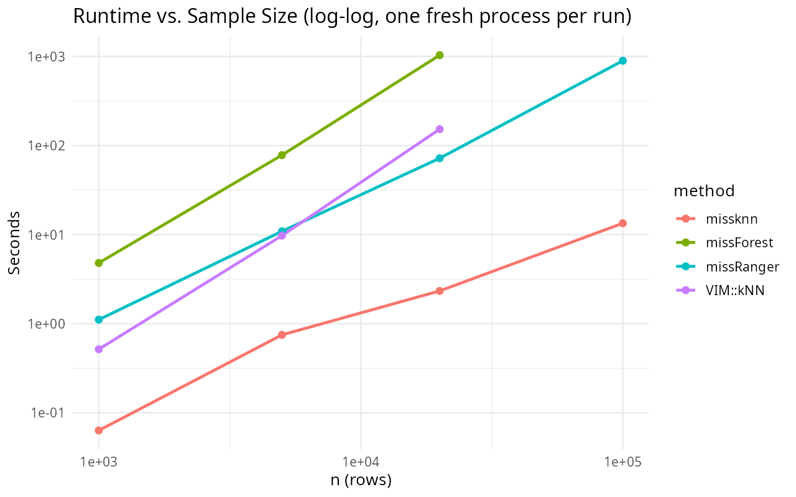
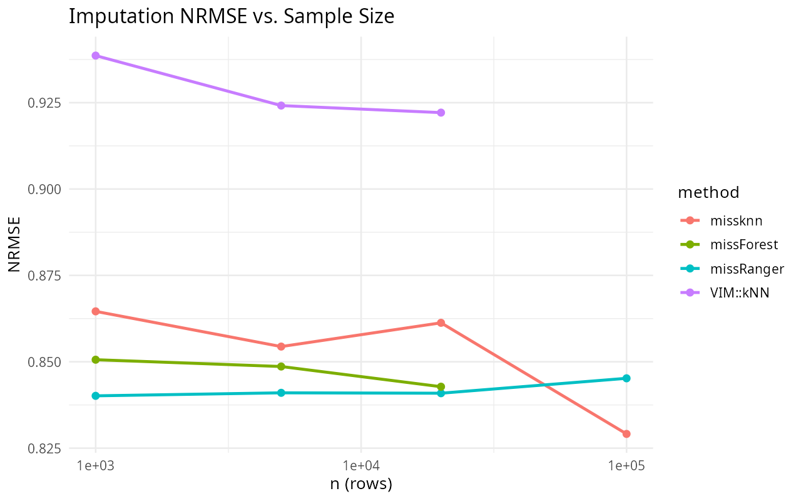

<!-- README.md is generated from README.Rmd. Please edit that file -->

# missknn

[](https://CRAN.R-project.org/package=missknn)

`missknn` is an R package for fast masked k-nearest neighbor imputation
of missing values in tabular data.

## Installation

Install the released version from CRAN with:

``` r
install.packages("missknn")
```

Or install the development version from GitHub with:

``` r
install.packages("remotes")
remotes::install_github("ielbadisy/missknn")
```

## What’s new in 1.2.0

- `missknn()` is now an imputer only and returns completed data
  directly: a `data.frame` when `m = 1`, a list of `m` completed data
  frames (class `c("mimar_mi", "list")`) when `m >= 2`.
- `complete()`, the `missknn` object class and its `print()`/`summary()`
  methods are removed; pool analyses with a dedicated package such as
  `mimar` (`mimar::pool_lm()`).
- `data.table` is no longer a dependency: tabular handling uses
  `basetable` (\>= 1.4.2) and outputs are plain data frames. Only `NA`
  cells are imputed (blank strings stay a valid category) and ordered
  factors are restored as ordered factors.
- The `"tuning"` attribute now reports the number of `missing` values
  per variable.

It is fast by design:

- distance computation, donor ranking, and aggregation are done in C++,
  with partial (not full) top-`k` selection and a batched per-column API
  that avoids per-cell R/C++ round trips
- each column’s `k` and estimator (distance-weighted mean vs. a local
  weighted-regression fit) are chosen automatically from a holdout
  evaluation, rather than fixed globally
- columns with no locally exploitable signal are detected and filled
  directly from the global mean/mode, skipping neighbor search entirely
- a `donor_cap` bounds the neighbor-search candidate pool so cost stays
  roughly linear in `n` instead of quadratic, which matters at large `n`
- `basetable` backend for tabular handling; input is a data frame or
  matrix, output is plain data frames
- multiple imputation (`m > 1`) can run multicore by default on
  Unix-like systems via `parallel::mclapply`
- within a single imputation, the per-column holdout `k`/estimator
  tuning and the deterministic (non-stochastic) neighbor search are
  parallelized across columns/receivers with `RcppParallel`, on all
  platforms including Windows

It supports:

- single imputation
- multiple imputation
- numeric and mixed tabular data
- an imputer-only interface: completed data in, analysis and pooling
  left to tools such as `mimar`

## About

`missknn` is developed and maintained by Imad El Badisy
(<elbadisyimad@gmail.com>), released under the MIT license.

## Latest Implementation

The current implementation parallelizes the per-column `k`/estimator
tuning and the deterministic single-imputation path with `RcppParallel`,
including on Windows. The `m > 1` stochastic path still uses
process-level parallelism via `parallel::mclapply` on Unix-like systems.

## Parallel computing

`missknn` parallelizes at two independent levels:

- **Across imputations** (`m > 1`): each of the `m` completed datasets
  is generated in a separate process via `parallel::mclapply`,
  controlled by `parallel_cores` (defaults to `detectCores() - 1`). This
  only applies on Unix-like systems; it falls back to serial on Windows.
- **Within a single imputation**: the per-column holdout search that
  picks each column’s `k` and estimator, and the deterministic (`m = 1`)
  neighbor search/aggregation, are split across threads with
  `RcppParallel::parallelFor` (across target columns for tuning, across
  receiver rows for imputation). This runs on every platform, including
  Windows, and benefits `m = 1` runs that get no benefit from
  `parallel_cores`. The stochastic sampling path used when `m > 1` stays
  single-threaded per process, since R’s RNG isn’t thread-safe; that
  case still parallelizes across the `m` processes instead.

Thread count for the `RcppParallel` layer follows the usual
`RcppParallel::setThreadOptions()` / `RCPP_PARALLEL_NUM_THREADS`
conventions.

## Progress reporting

``` r
imp <- missknn(big_data, k = 5, progress = TRUE)
```

With `progress = TRUE`, `missknn()` shows a live, self-contained (base R
only, no extra dependency) progress bar for each tuning stage
(`Tuning numeric columns`, `Tuning categorical columns`) and for each
column that goes through the neighbor search (`Imputing <column>`),
updating in place with a percentage and an ETA, e.g.:

    Imputing x2              [===========>------------------]  38%  ETA: 4s

Columns with no locally exploitable signal (filled directly from the
global mean/mode, see the `missknn()` API entry below) don’t get a bar,
since they skip the neighbor search entirely.

Because `RcppParallel` worker threads can’t safely drive a progress
display, requesting `progress = TRUE` runs that column’s search on a
single thread instead of in parallel: an explicit, visible-vs-fast
tradeoff, not a bug. Leave `progress = FALSE` (the default) for the
fastest run. `progress` is also automatically disabled whenever `m > 1`
with `parallel_cores > 1`, since console output from
`parallel::mclapply`’s forked worker processes can’t be shown live.

## Benchmark

Two benchmark scripts write reports, plots, and CSV tables to
`inst/benchmark/output/`:

``` r
# accuracy/runtime vs. missForest, missMDA, VIM::kNN at n = 200, 30 simulations
Rscript inst/benchmark/benchmark_30.R

# runtime/accuracy vs. missMDA and missForest as n scales from 1,000 to 100,000
Rscript inst/benchmark/benchmark_bigdata.R
```

## API

### `missknn(data, k = 5L, m = 1L, scale = TRUE, add_indicator = FALSE, seed = NULL, weights = c("distance", "uniform"), numeric_estimator = c("regression", "mean"), ridge = 1e-4, donor_cap = 2000L, max_iter = 1L, parallel_cores = missknn_default_cores(), progress = FALSE)`

Fits masked KNN imputation and returns the completed data.

| Argument            | Description                                                                                                                                                                                                                                                         |
|---------------------|---------------------------------------------------------------------------------------------------------------------------------------------------------------------------------------------------------------------------------------------------------------------|
| `data`              | A `data.frame` or matrix.                                                                                                                                                                                                                                           |
| `k`                 | Number of nearest donors used per target column.                                                                                                                                                                                                                    |
| `m`                 | Number of completed datasets. `m = 1` is single (deterministic) imputation; `m > 1` is multiple (stochastic donor-sampling) imputation.                                                                                                                             |
| `scale`             | Standardize numeric variables before computing distances.                                                                                                                                                                                                           |
| `add_indicator`     | Append 0/1 integer missingness-indicator columns (`<name>_missing`) to the completed output.                                                                                                                                                                        |
| `seed`              | Integer seed for reproducible multiple imputation.                                                                                                                                                                                                                  |
| `weights`           | `"distance"` (inverse-distance weighted aggregation) or `"uniform"` (equal weights) over the `k` donors.                                                                                                                                                            |
| `numeric_estimator` | `"regression"` fits a distance-weighted local linear regression of the target on the receiver’s observed numeric predictors over the `k` donors, falling back to the weighted mean when the local design is degenerate; `"mean"` always uses the weighted mean.     |
| `ridge`             | Ridge penalty added to the predictor covariance under `numeric_estimator = "regression"`.                                                                                                                                                                           |
| `donor_cap`         | Caps the donor pool searched per target column, subsampling once per column when exceeded, so search cost stays roughly linear in `n`. Does not affect the global mean/mode fallback, which always uses every donor.                                                |
| `max_iter`          | Number of single-pass refinement iterations over the whole dataset.                                                                                                                                                                                                 |
| `parallel_cores`    | Cores used across the `m` completed datasets when `m > 1` (via `parallel::mclapply`, Unix-like only). Defaults to `detectCores() - 1`. Independent of the `RcppParallel` threading used within a single imputation (see [Parallel computing](#parallel-computing)). |
| `progress`          | Show a live console progress bar per tuning stage and per imputed column (see [Progress reporting](#progress-reporting)). Default `FALSE`.                                                                                                                          |

Columns with no locally exploitable signal are detected during fitting
and filled from the global mean/mode directly, without a neighbor
search.

Returns completed data directly:

- `m = 1`: a `data.frame` with the same columns and column types as the
  input.
- `m >= 2`: a list of `m` completed data frames with class
  `c("mimar_mi", "list")`.

`missknn` is an imputer only. Fit the analysis model on each completed
data set and pool the fits with Rubin’s rules using a dedicated package
such as `mimar` (`mimar::pool_lm()`).

## Example

``` r
library(missknn)

x <- data.frame(
  a = c(1.2, 2.1, NA, 4.3, 5.0, 6.4, NA, 8.1),
  b = c(2.5, NA, 3.1, 5.2, 4.8, NA, 7.9, 8.3),
  g = factor(c("x", "x", "y", NA, "y", "x", "y", NA))
)

missknn(x, k = 2)
#>          a        b g
#> 1 1.200000 2.500000 x
#> 2 2.100000 2.641362 x
#> 3 3.450772 3.100000 y
#> 4 4.300000 5.200000 y
#> 5 5.000000 4.800000 y
#> 6 6.400000 8.117406 x
#> 7 7.621611 7.900000 y
#> 8 8.100000 8.300000 y
```

Each result carries a `"tuning"` attribute giving, per variable, the
number of `missing` values, the tuned `k`, the `estimator` used and
whether it was filled from the global mean/mode:

``` r
attr(missknn(x, k = 2), "tuning")
#>   variable missing k  estimator global
#> a        a       2 2 regression  FALSE
#> b        b       2 2 regression  FALSE
#> g        g       2 2       vote  FALSE
```

Multiple imputation returns a list of completed data frames, ready for
analysis and pooling with `mimar`:

``` r
# multiple imputation: a list of 5 completed data frames
imps <- missknn(x, k = 2, m = 5, seed = 1, parallel_cores = 1L)
class(imps)
#> [1] "mimar_mi" "list"
imps[[2]]
#>     a   b g
#> 1 1.2 2.5 x
#> 2 2.1 2.5 x
#> 3 1.2 3.1 y
#> 4 4.3 5.2 y
#> 5 5.0 4.8 y
#> 6 6.4 8.3 x
#> 7 8.1 7.9 y
#> 8 8.1 8.3 y
fits <- lapply(imps, function(d) lm(a ~ b, data = d))
mimar::pool_lm(fits)
#> Pooled linear model
#> Pooled across m = 5 imputations (Rubin's rules)
#> 
#>             Estimate Std. Error    df t value Pr(>|t|)  
#> (Intercept)  -0.2727     1.6125 2.123  -0.169   0.8805  
#> b             0.9660     0.2412 3.110   4.004   0.0261 *
#> ---
#> Signif. codes:  0 '***' 0.001 '**' 0.01 '*' 0.05 '.' 0.1 ' ' 1
```

## Execution time vs. sample size

Runtime and NRMSE from n = 1,000 up to n = 100,000 (5 numeric columns,
20% MCAR per column). `missForest` and `VIM::kNN` are only run up to n =
5,000 (per-tree cost and O(n^2) distance search respectively make larger
n impractical); `missknn` and `missRanger` run across the full grid.
Reproduce with:

``` r
Rscript inst/benchmark/benchmark_bigdata.R
```

<figure>

<figcaption aria-hidden="true">Runtime plot</figcaption>
</figure>

<figure>

<figcaption aria-hidden="true">NRMSE plot</figcaption>
</figure>

|       n | method     | runtime_sec |   nrmse |
|--------:|:-----------|------------:|--------:|
|   1,000 | missknn    |      0.0131 | 1.00223 |
|   1,000 | missRanger |      0.1630 | 1.15781 |
|   1,000 | missForest |      3.1537 | 1.07461 |
|   1,000 | VIM::kNN   |      0.6088 | 1.16132 |
|   5,000 | missknn    |      0.0321 | 1.00020 |
|   5,000 | missRanger |      1.3632 | 1.14478 |
|   5,000 | missForest |     75.1881 | 1.03685 |
|   5,000 | VIM::kNN   |     10.9076 | 1.15992 |
|  20,000 | missknn    |      0.0456 | 0.99998 |
|  20,000 | missRanger |     10.3372 | 1.14941 |
| 100,000 | missknn    |      0.0938 | 1.00000 |
| 100,000 | missRanger |     85.6539 | 1.14435 |

Runtime and NRMSE by method and sample size

`missForest`’s runtime already becomes impractical at n = 5,000 (over a
minute) and would take hours at n = 100,000; `VIM::kNN`’s distance
search is similarly infeasible past a few thousand rows. `missknn`’s
capped-donor masked-KNN search stays close to linear in `n` and keeps
running in well under a second even at n = 100,000. `missRanger` also
scales to n = 100,000 but at substantially higher runtime.

## Citation

``` r
citation("missknn")
#> To cite missknn in publications, use:
#> 
#>   El Badisy I (2026). _missknn: Fast Masked K-Nearest Neighbor
#>   Imputation_. R package version 1.2.0,
#>   <https://CRAN.R-project.org/package=missknn>.
#> 
#> A BibTeX entry for LaTeX users is
#> 
#>   @Manual{,
#>     title = {missknn: Fast Masked K-Nearest Neighbor Imputation},
#>     author = {Imad {El Badisy}},
#>     year = {2026},
#>     note = {R package version 1.2.0},
#>     url = {https://CRAN.R-project.org/package=missknn},
#>   }
```
