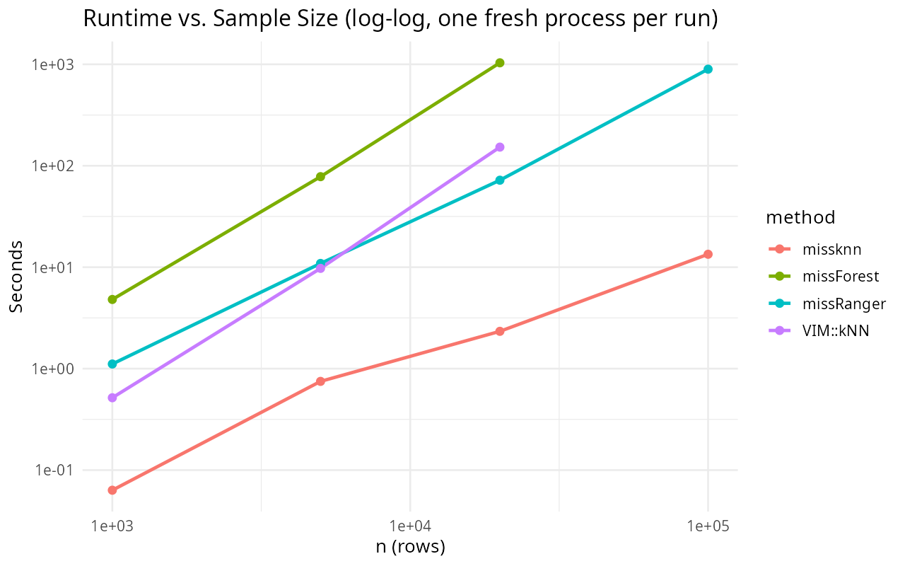
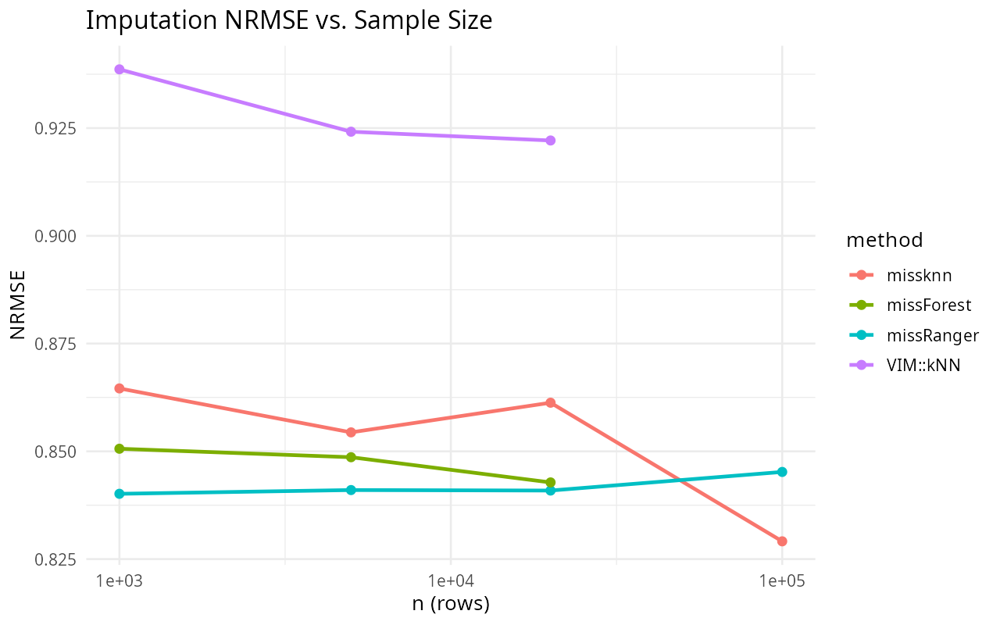

# missknn Big-Data Benchmark Report

Runtime and imputation accuracy (NRMSE) vs. sample size, from n = 1,000
up to n = 100,000 (5 equicorrelated Gaussian columns, rho = 0.5, 20% MCAR per column). Each
(n, method) run executes in its own fresh `Rscript` process, so timings
are not distorted by heap growth accumulated across earlier, larger runs
in a shared session. All four methods run across the full grid; the
slow cells (`missForest` and `VIM::kNN` beyond n = 5,000) ran side by
side in separate processes, one core each.

## Figures

## Results Table

Table: Runtime and NRMSE by method and sample size (one fresh Rscript process per run)

|n       |method     | runtime_sec|   nrmse|
|:-------|:----------|-----------:|-------:|
|1,000   |missknn    |      0.0633| 0.86460|
|5,000   |missknn    |      0.7489| 0.85440|
|20,000  |missknn    |      2.3324| 0.86128|
|100,000 |missknn    |     13.4156| 0.82911|
|1,000   |missRanger |      1.1108| 0.84014|
|5,000   |missRanger |     10.8911| 0.84101|
|20,000  |missRanger |     72.0325| 0.84090|
|100,000 |missRanger |    895.6723| 0.84521|
|1,000   |missForest |      4.8080| 0.85060|
|5,000   |missForest |     78.0657| 0.84863|
|1,000   |VIM::kNN   |      0.5166| 0.93863|
|5,000   |VIM::kNN   |      9.7381| 0.92416|
|20,000  |missForest |   1034.6335| 0.84278|
|100,000 |missForest |          NA|      NA|
|20,000  |VIM::kNN   |    152.6622| 0.92212|
|100,000 |VIM::kNN   |          NA|      NA|

## Failed cells

- n = 100000, missForest: No result after 2h08m33s of CPU-bound execution; stopped as non-terminating for the 100,000-row setting.
- n = 100000, VIM::kNN: No result after 38m43s of CPU-bound execution with memory pressure; stopped as infeasible for the 100,000-row setting.

