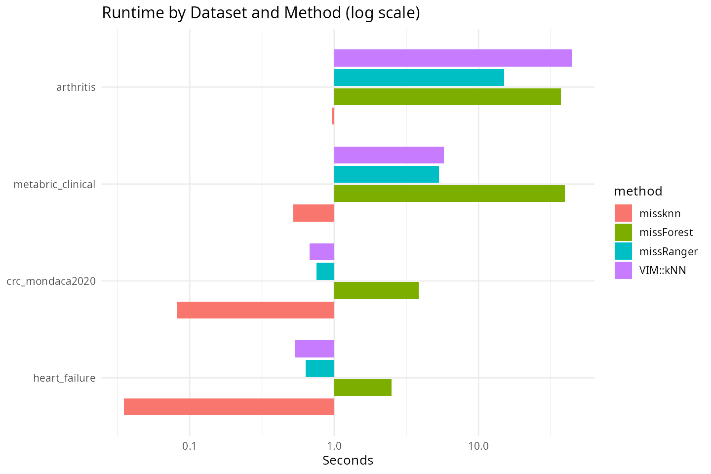
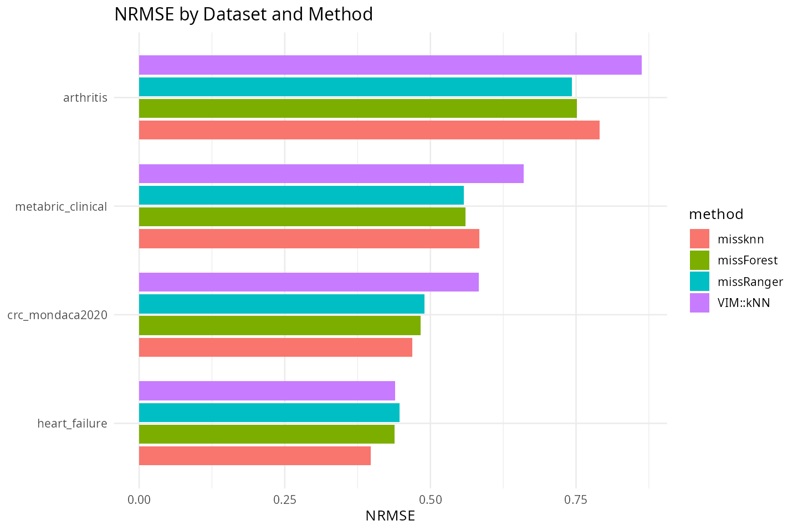

# missknn Real-Data Benchmark Report

Metrics follow Stekhoven & Buhlmann (2012): NRMSE for numeric variables
and PFC (proportion falsely classified) for categorical variables, both
pooled across every artificially-masked entry of that type rather than
averaged per column first. 30% MCAR imposed on complete-case ground
truth for each dataset.

## Dataset selection

Four biomedical/clinical datasets from `biostatlab`, kept to a size
appropriate for an Application Note: `heart_failure`, `crc_mondaca2020`,
`arthritis` and `metabric_clinical`.
Empty strings in categorical columns are treated as missing before the
complete-case ground truth is formed. The real-data scaling point
(`diabetes_prediction`, n = 100,000) is in benchmark_real_bign.R.

## Figures

## Main Results Table

Table: Runtime, NRMSE, and PFC on real biomedical datasets (30% MCAR)

|dataset           |method     |    n|  p| runtime_sec|  nrmse|    pfc|
|:-----------------|:----------|----:|--:|-----------:|------:|------:|
|heart_failure     |missknn    |  299| 13|       0.035| 0.3975| 0.3571|
|heart_failure     |missForest |  299| 13|       2.498| 0.4385| 0.4135|
|heart_failure     |missRanger |  299| 13|       0.635| 0.4466| 0.4229|
|heart_failure     |VIM::kNN   |  299| 13|       0.534| 0.4394| 0.4342|
|crc_mondaca2020   |missknn    |  457| 11|       0.082| 0.4693| 0.4109|
|crc_mondaca2020   |missForest |  457| 11|       3.841| 0.4833| 0.4275|
|crc_mondaca2020   |missRanger |  457| 11|       0.757| 0.4900| 0.4350|
|crc_mondaca2020   |VIM::kNN   |  457| 11|       0.678| 0.5827| 0.4486|
|arthritis         |missknn    | 4856| 11|       0.963| 0.7905| 0.2255|
|arthritis         |missForest | 4856| 11|      37.260| 0.7517| 0.2678|
|arthritis         |missRanger | 4856| 11|      15.046| 0.7431| 0.2212|
|arthritis         |VIM::kNN   | 4856| 11|      44.337| 0.8630| 0.2462|
|metabric_clinical |missknn    | 1778| 11|       0.522| 0.5839| 0.3486|
|metabric_clinical |missForest | 1778| 11|      39.775| 0.5602| 0.3253|
|metabric_clinical |missRanger | 1778| 11|       5.314| 0.5576| 0.3078|
|metabric_clinical |VIM::kNN   | 1778| 11|       5.768| 0.6605| 0.3508|

