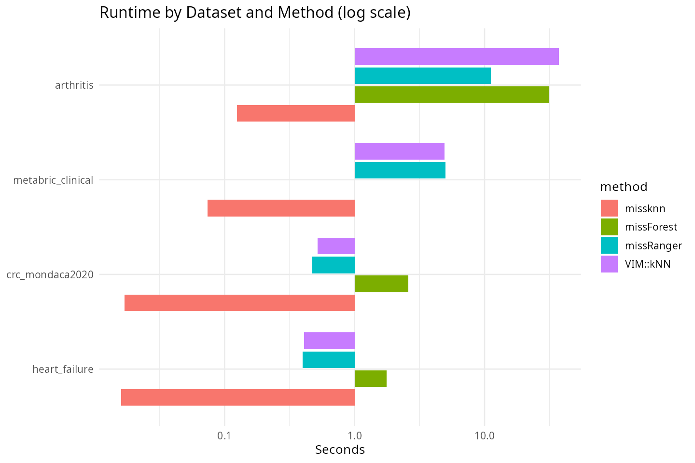
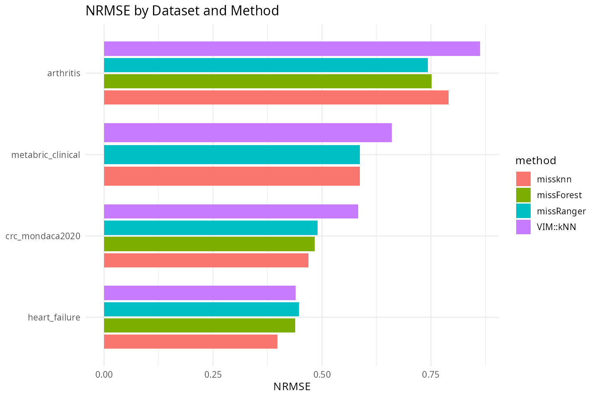

# missknn Real-Data Benchmark Report

Metrics follow Stekhoven & Buhlmann (2012): NRMSE for numeric variables
and PFC (proportion falsely classified) for categorical variables, both
pooled across every artificially-masked entry of that type rather than
averaged per column first. 30% MCAR imposed on complete-case ground
truth for each dataset.

## Dataset selection

Four biomedical/clinical datasets from `biostatlab`, kept to a size
appropriate for an Application Note while spanning a range of outcomes:
`heart_failure` (missknn wins outright), `crc_mondaca2020` (missknn wins
on speed and numeric accuracy, loses on categorical accuracy),
`arthritis` (missknn wins on speed only), and `metabric_clinical`
(missForest fails outright on a rare categorical level; missknn and
missRanger both complete, missRanger slightly more accurate).
`diabetes_prediction` (n = 100,000) is reported separately as a real-data
scaling point.

## Figures

## Main Results Table

Table: Runtime, NRMSE, and PFC on real biomedical datasets (30% MCAR)

|dataset           |method     |    n|  p| runtime_sec|  nrmse|    pfc|
|:-----------------|:----------|----:|--:|-----------:|------:|------:|
|heart_failure     |missknn    |  299| 13|       0.016| 0.3975| 0.3571|
|heart_failure     |missForest |  299| 13|       1.762| 0.4385| 0.4135|
|heart_failure     |missRanger |  299| 13|       0.397| 0.4466| 0.4229|
|heart_failure     |VIM::kNN   |  299| 13|       0.409| 0.4394| 0.4342|
|crc_mondaca2020   |missknn    |  457| 11|       0.017| 0.4693| 0.4109|
|crc_mondaca2020   |missForest |  457| 11|       2.590| 0.4833| 0.4275|
|crc_mondaca2020   |missRanger |  457| 11|       0.471| 0.4900| 0.4350|
|crc_mondaca2020   |VIM::kNN   |  457| 11|       0.518| 0.5827| 0.4486|
|arthritis         |missknn    | 4856| 11|       0.124| 0.7905| 0.2255|
|arthritis         |missForest | 4856| 11|      31.120| 0.7517| 0.2678|
|arthritis         |missRanger | 4856| 11|      11.212| 0.7431| 0.2212|
|arthritis         |VIM::kNN   | 4856| 11|      37.407| 0.8630| 0.2462|
|metabric_clinical |missknn    | 1839| 11|       0.074| 0.5873| 0.3192|
|metabric_clinical |missForest | 1839| 11|          NA|     NA|     NA|
|metabric_clinical |missRanger | 1839| 11|       4.986| 0.5872| 0.3199|
|metabric_clinical |VIM::kNN   | 1839| 11|       4.912| 0.6605| 0.3448|

## Real-Data Scaling Point (n = 100,000)

Table: diabetes_prediction (n = 100,000): missForest excluded as computationally intractable at this n

|dataset             |method     |n       |  p| runtime_sec|  nrmse| pfc|
|:-------------------|:----------|:-------|--:|-----------:|------:|---:|
|diabetes_prediction |missknn    |100,000 |  9|      21.656| 0.3569|  NA|
|diabetes_prediction |missRanger |100,000 |  9|     392.742| 0.3754|  NA|

